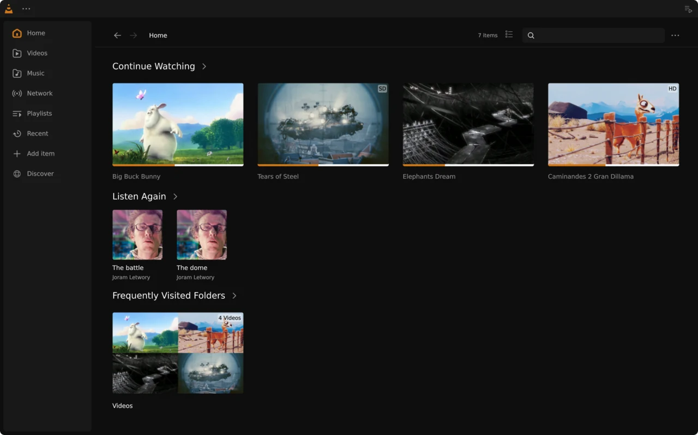
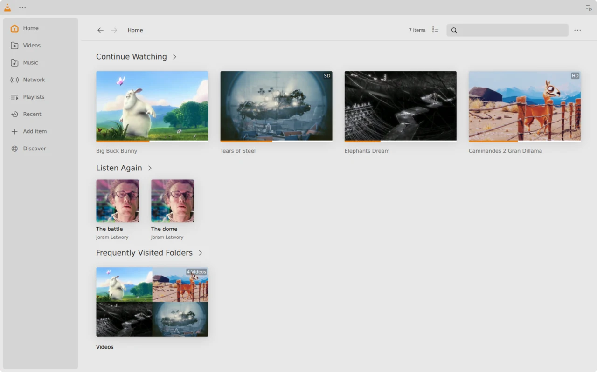
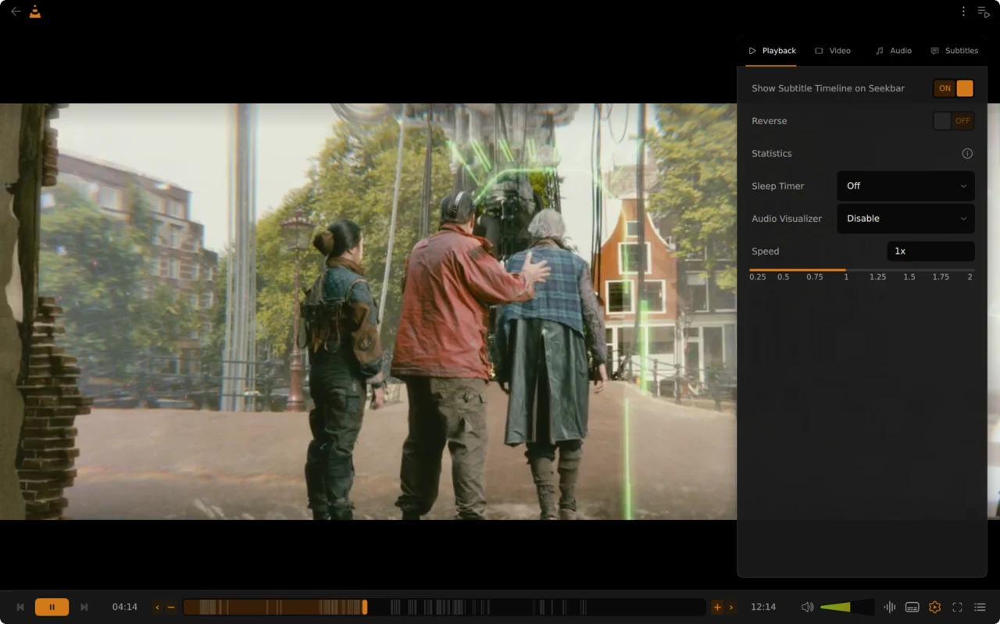
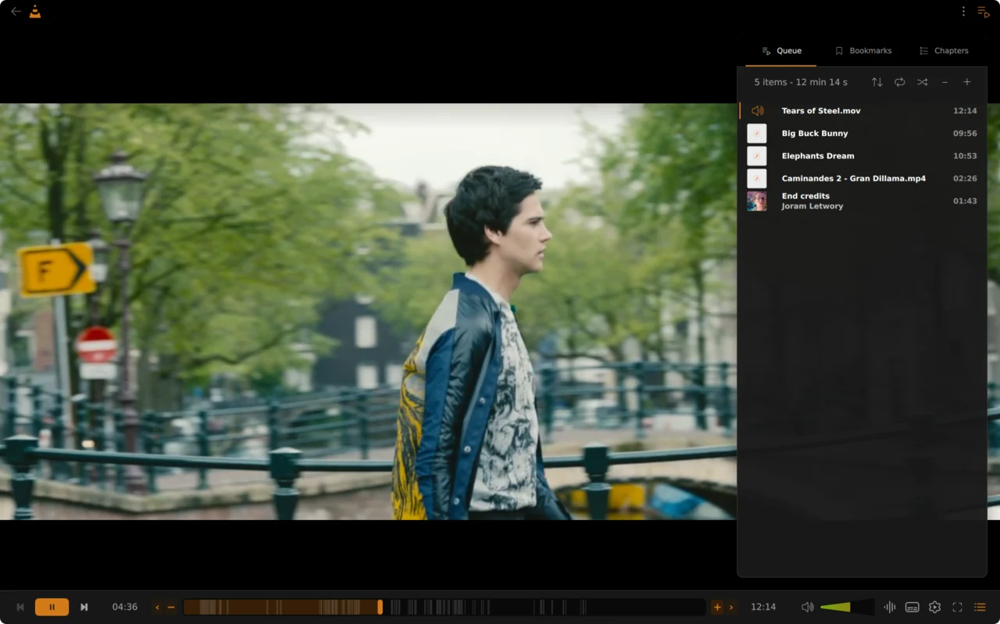
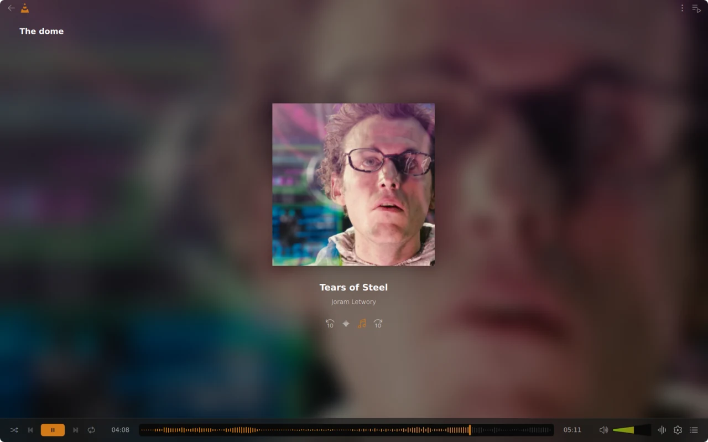
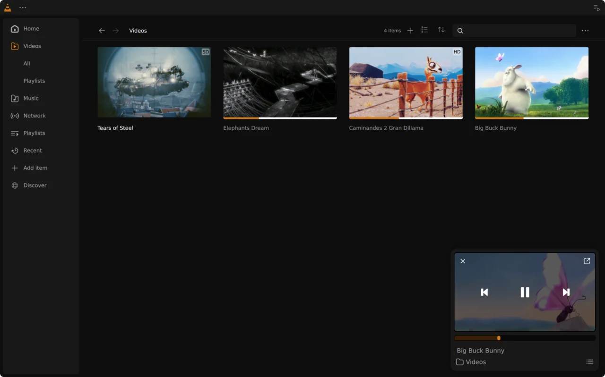
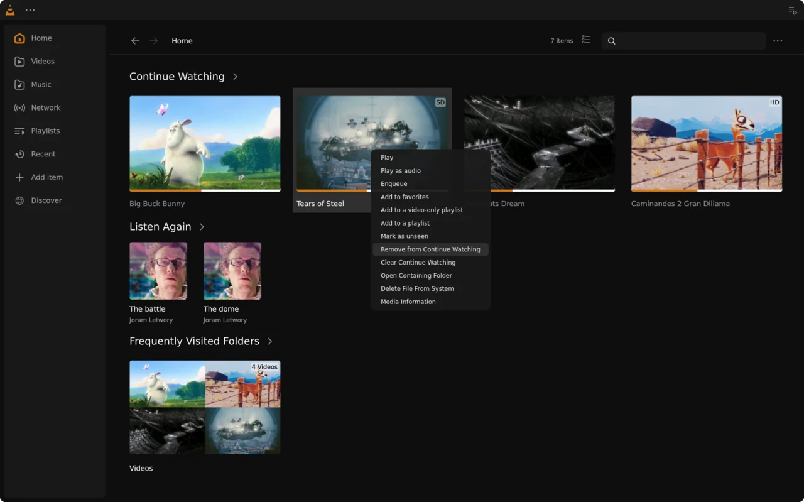
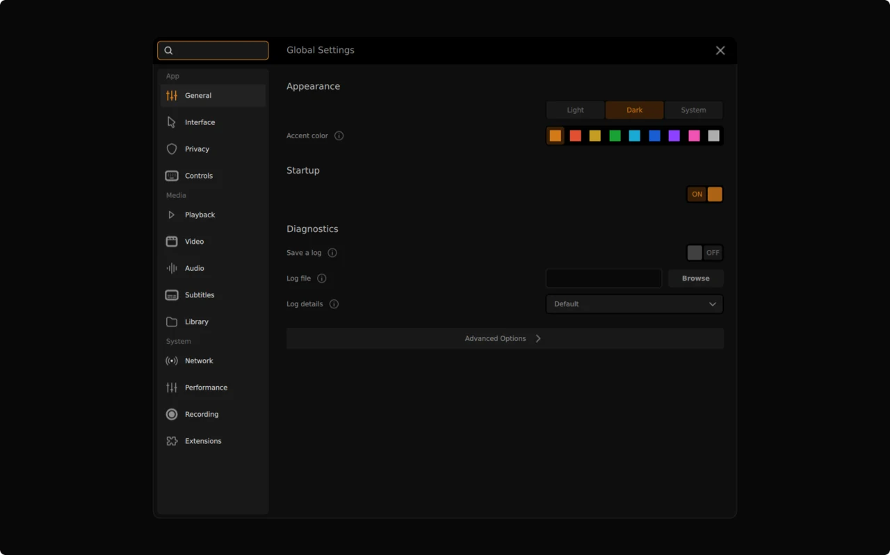
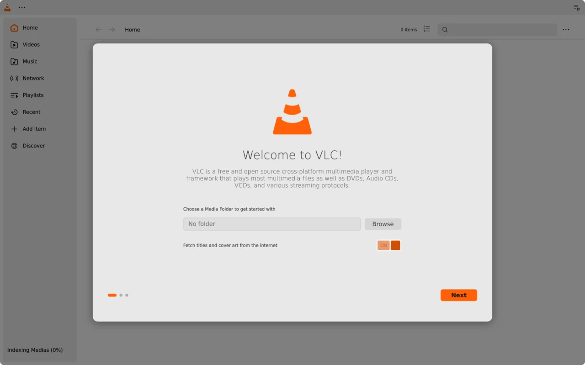

# VLC media player

This is a fork of VLC 4 (the development branch) with a redesigned Qt
interface. The design is by [Juxtopposed](https://www.youtube.com/@juxtopposed),
from their VLC redesign concept. This fork implements that design in VLC's QML
interface and adds a few features and fixes on top.



<table>
  <tr>
    <td width="50%"></td>
    <td width="50%"></td>
  </tr>
  <tr>
    <td align="center">Light theme</td>
    <td align="center">Playback settings and the subtitle timeline</td>
  </tr>
  <tr>
    <td width="50%"></td>
    <td width="50%"></td>
  </tr>
  <tr>
    <td align="center">Play queue</td>
    <td align="center">Audio level on the seek bar</td>
  </tr>
  <tr>
    <td width="50%"></td>
    <td width="50%"></td>
  </tr>
  <tr>
    <td align="center">Mini player</td>
    <td align="center">Removing a video from Continue Watching</td>
  </tr>
  <tr>
    <td width="50%"></td>
    <td width="50%"></td>
  </tr>
  <tr>
    <td align="center">Settings</td>
    <td align="center">Onboarding</td>
  </tr>
</table>

## The redesign

### Library

The navigation panel is a rounded panel with gaps around it, drawn with the
outline icons of the design. The current page is shown in the accent colour.
Video is renamed to Videos and Browse to Network.

The home page shows Continue Watching, Listen Again (recently played audio)
and Frequently Visited Folders in place of Favorites, New Videos and New
Music. The library header, page menus, playlists and item counts follow the
design, and the Videos, Artists and Genres lists no longer have a column
header, since the sort menu in the page header does the same job.

Both the light and the dark theme use the colours of the design. The System
theme takes its colours from the system palette.

### Player

The control bar fits on one row: previous, play and next, the time and seek
bar, the volume, and the remaining buttons. The volume is a wedge that fills
from green to red.

The seek bar shows the audio level for audio files. For videos it can show
where the subtitle lines are: turn on "Show Subtitle Timeline on Seekbar" in
the playback settings, and use the + and − buttons next to the seek bar to
zoom in.

The settings button opens a side panel with Playback, Video, Audio and
Subtitles tabs. They cover tracks, delays, speed, the audio visualizer and a
sleep timer.

The queue button opens a panel with Queue, Bookmarks and Chapters tabs.

### Mini player

When you go back to the library during playback, the video keeps playing in a
card at the bottom right, with rounded corners, a seek bar, the title, the
folder and the artist. The controls appear when you hover over the video. The
queue opens as its own panel, and the mini player moves left to make room for
it.

### Menu and settings

The ⋯ button at the top left opens a menu in the style of the design,
which replaces the native overflow menu. It opens files, discs and network
streams, the player customization, Settings, About and Quit. Settings moved
there from the navigation panel, and opens as a dialog in the style of the
design.

### First run

On the first start, an onboarding dialog asks for a media folder, whether to
fetch titles and cover art from the internet, and the theme and accent
colour, then shows the basic keyboard shortcuts. The keyboard shortcuts,
network stream, playlist and subtitle dialogs also follow the design.

## Other features

- **Accent colour**: pick one of nine accent colours in the onboarding or in
  Settings → General. It applies after VLC restarts.
- **Continue Watching**: right-click a video in Continue Watching (or on the
  Recent page) and choose "Remove from Continue Watching", or "Clear Continue
  Watching" to empty the list. Removing a video resets its progress but keeps
  it in the library. Clearing asks first, and leaves the audio and stream
  history alone.
- **Hand cursor**: buttons, tabs, sliders, menu items, grid cards and list
  rows show the hand cursor. Disabled controls keep the arrow.
- **System theme**: tool buttons are drawn as plain icons, and the Settings
  and Keyboard Shortcuts dialogs use the system palette, like the rest of the
  interface.
- **Faster menus**: menus and Settings react to hover sooner. Settings is
  created when it opens and unloaded when it closes.

## Fixes

- Fixed a crash on startup when the settings hold a graphics API from a
  previous run.
- On X11, the interface no longer disappears over the video after the window
  is resized.
- YouTube videos played through yt-dlp no longer play without sound. When no
  format has both audio and video, VLC opens the HLS manifest instead.
- Play queue rows without an artist have their title centred.
- The media library builds against current medialibrary master.

## Installing

There are no prebuilt binaries, so this fork has to be built from source. It
is based on VLC 4, while most distributions ship VLC 3, and it needs a media
library built from git. Install `yt-dlp` to play YouTube and other web videos.

### Arch Linux

`extras/package/arch/PKGBUILD` builds this fork with the media library and
installs it to `/opt/vlc`, with `/usr/bin/vlc`, a desktop entry and icons:

```
cd extras/package/arch && makepkg -si
```

It builds the checkout it is in as it is, including uncommitted changes, and
the version ends in `.dirty` when there are any. To build from GitHub instead,
set `VLC_GIT_URL=https://github.com/joeyshi12/vlc.git`, and `VLC_GIT_BRANCH`
for a branch other than master. The package conflicts with Arch's `vlc`
package.

### Other Linux distributions

These steps follow the PKGBUILD and install everything to `/opt/vlc`, so they
don't clash with the distribution's VLC 3.

1. Install the build tools and libraries. You need Meson 1.10 or later
   (`pip install --user meson` if your distribution's is older), Ninja, a C
   and C++ compiler, Qt 6.2 or later with Qt Declarative, Qt SVG and Qt Shader
   Tools, and the development packages for the libraries VLC uses. The
   `depends` and `makedepends` lists in `extras/package/arch/PKGBUILD` name
   them. On Debian and Ubuntu, `sudo apt build-dep vlc` installs most of them,
   with Qt 5 in place of Qt 6.

2. Get the sources. libvlcpp and medialibrary are pinned to the commits that
   build with this tree:

   ```
   git clone https://github.com/joeyshi12/vlc.git
   git clone https://code.videolan.org/videolan/libvlcpp.git
   git -C libvlcpp checkout 3095992b779ef7ee4487f39f936f8ab3750cb23a
   git clone https://code.videolan.org/videolan/medialibrary.git
   git -C medialibrary checkout 5528c2faabfe04ce96e7b26d2dcf6ce742568c79
   ```

3. Build VLC, then libvlcpp and medialibrary against it, then VLC again so
   that it includes the media library plugin:

   ```
   prefix=/opt/vlc
   export PKG_CONFIG_PATH=$prefix/lib/pkgconfig
   export LDFLAGS="-Wl,-rpath,$prefix/lib:$prefix/lib/vlc"
   opts="--prefix=$prefix --libdir=lib --buildtype=release"

   meson setup build-vlc vlc $opts -Dvulkan=disabled
   meson compile -C build-vlc && sudo meson install -C build-vlc

   meson setup build-libvlcpp libvlcpp $opts -Dtests=disabled -Dexamples=disabled
   sudo meson install -C build-libvlcpp
   meson setup build-medialibrary medialibrary $opts -Dtests=disabled
   meson compile -C build-medialibrary && sudo meson install -C build-medialibrary

   meson setup --reconfigure build-vlc vlc
   meson compile -C build-vlc && sudo meson install -C build-vlc
   sudo $prefix/libexec/vlc/vlc-cache-gen $prefix/lib/vlc/plugins
   ```

4. Run it with `/opt/vlc/bin/vlc`, or link it into your `PATH`:
   `sudo ln -s /opt/vlc/bin/vlc /usr/local/bin/vlc`.

### Windows

VLC for Windows is cross-compiled with mingw-w64 from Linux, WSL or msys2.
MSVC is not supported. The quickest setup is VideoLAN's Docker image, which
has the toolchain installed:

```
git clone https://github.com/joeyshi12/vlc.git
docker run -it --rm -v "$PWD/vlc:/vlc" -w /vlc \
    registry.videolan.org/vlc-debian-win64:latest bash
```

Inside the container, or in a WSL or msys2 shell set up as described in
[doc/BUILD-win32.md](doc/BUILD-win32.md):

```
mkdir win64 && cd win64
../extras/package/win32/build.sh -a x86_64 -r -m -i r
```

This builds the third-party libraries under `contrib/`, which takes a long
time on the first run, then VLC, and writes an NSIS installer (`vlc-*.exe`)
to `win64/`. Use `-i u` for a zip archive instead of an installer. Copy the
file to Windows and run it.

The contrib build uses medialibrary 0.13.2, which is older than the version
this fork's media library module is written for, so that module does not
compile yet on Windows. The X11 fix above does not apply on Windows.

## Credits

The interface design is by [Juxtopposed](https://www.youtube.com/@juxtopposed).

The screenshots show Blender Foundation open movies, licensed under Creative
Commons Attribution: [Big Buck Bunny](https://peach.blender.org/) (CC BY 3.0),
[Elephants Dream](https://orange.blender.org/) (CC BY 2.5),
[Tears of Steel](https://mango.blender.org/) (CC BY 3.0) and
[Caminandes 2: Gran Dillama](https://www.caminandes.com/) (CC BY), all
© Blender Foundation. The music is the Tears of Steel soundtrack, © Joram
Letwory (www.tearsofsteel.org), CC BY-ND 3.0; its cover is a frame from the
film.

## License

The license is the same as upstream VLC: GPLv2 or later, and LGPLv2 or later
for libVLC.
